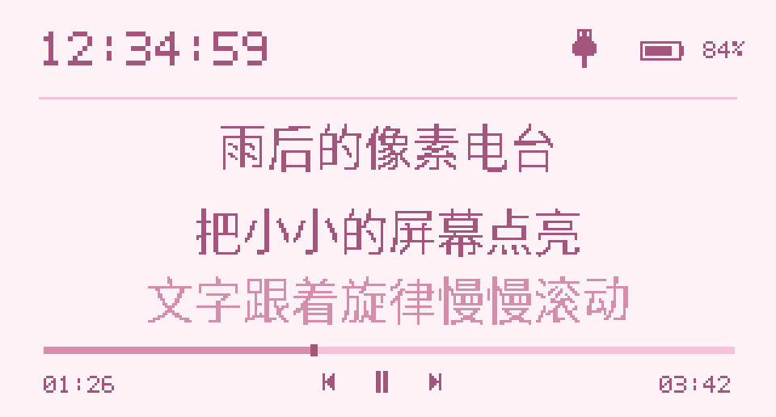

# Rainy75 V2 TFT

给 Rainy75 V2 小屏幕加上可定制像素界面。项目分为两部分：原有的**基础屏幕版**，以及新加入的**歌词播放器扩展**；按需要选择，不必为了改图标安装全部功能。也记录把 AI 用于外设开发的一些方法。

**实验性源码项目 · `0.2.0-alpha.2` · 自有代码 MIT License**

| 入口 | 基础屏幕版 · 原功能 | 歌词播放器扩展 · 新功能 |
| --- | --- | --- |
| 作用 | 大单键、时钟、电量、连接图标、设备缓存动画 | 保留按键页，新增全宽歌名、滚动歌词与进度 |
| 电脑后台 | 日常显示不需要 | Windows 后台持续运行，控制网页可关闭 |
| 连接 | 原生事件可用于 USB / 2.4G / 蓝牙，依实际设备 | PC 歌词同步仅 USB 有线 |
| 字库与安装 | 无额外字库；普通 IPS | 额外 LY1 屏幕固件与一次性 FONT.BIN 上传 |
| 使用文档 | [基础版使用方法](docs/usage.md) | [歌词版安装与控制台](docs/lyrics.md) |
| AI 定制 | [基础版提示词](docs/ai-guide.md#基础版改图标与主题) | [歌词版提示词](docs/ai-guide.md#歌词版改布局与控制台) |


上图为软件渲染预览，使用示例时间与电量，**不是实机照片**。默认角色是本项目绘制的几何像素机器人，提供樱花粉、薄荷绿、墨水灰三套配色。

## 基础屏幕版：原有功能

- 由键盘原生通知显示最近按下的单个键，松开后保留；首次启动显示 `--`。
- 支持大号导航图标、细线方向箭头、居中的 Win 四格图标，以及 `ESC` / `CTRL` / `ALT` 文字。
- 按键盘发来的 Shift 状态映射常见美式布局上档符号。
- 使用原生电量、USB / 2.4G / 蓝牙状态通知；无需电脑全局键盘钩子。
- 播放本地缓存 GIF，在同一帧中合成动态内容；正常运行不用反复上传整张图片。
- 通过 USB 网页校时；用 JSON 编辑图标，用源码和模板生成器调整界面。

## 歌词播放器：新增扩展


上图为公开源码与原创示例文字的软件渲染，**不是实机照片**。歌词页不显示角色，切回按键页保留原创机器人；字形来自 Noto CJK，见 [字体许可](licenses/OFL-1.1.txt)。

默认是 **04 大字字幕**：20px 歌名与 40px 当前句同时显示。控制台可切回 20px 双行，两个字号共用一份屏内字库，40px 为整数两倍绘制，保留像素感；切换字号无需重刷或重传字库。



上图为可选的 20px 布局，同样是模型执行公开固件所得的软件预览。

- 自动选择 QQ 音乐 / 网易云当前媒体会话，显示曲名、歌词和播放进度；20px 模式含下一句，40px 模式聚焦当前句。
- 中文、繁中、日文、英文混排；长歌名独立滚动，长歌词分段与横向滚动，换句有上下过渡。
- 屏内字库和动画一次性缓存；换句发送字形编号，屏幕复用已准备的歌名和下一句。
- Ctrl＋F8 全局切换两页；只注册该快捷键，不采集全局按键或按键历史。
- 本机控制台调整歌词偏移：±10 秒、0.1 秒精度、±0.5 秒按钮、一键归零、自动保存；支持本地 LRC、重新匹配与登录自启。
- 按歌手、版本及时长筛选歌词；优先同平台，多个候选和退避重试减少缺词、误配。
- 更换字库时可提供旧 `FONT.BIN`，通过固定文件替换接口核对旧头部和大小，再释放旧文件空间；流程与恢复说明见 [字库替换](docs/lyrics.md#更换已有字库)。

QQ 歌词与设备提交有单台开发设备使用记录；网易云新进度适配仍待实机复核，歌词接口也可能变化。详细安装、数据流与限制见 [歌词文档](docs/lyrics.md)。


控制台截图使用原创演示数据，不连接键盘或真实播放器。偏移按钮、数值输入和保存行为均可离线体验。

基础版的图标工作台：


截图是未连接硬件时的浏览器界面。模板预览和设备实时状态分别展示，界面不会把演示数值当成设备读数。

## 先了解状态

| 部分 | 公开候选 | 验证情况 |
| --- | --- | --- |
| IPS 基础界面 | 0.6.3 / L6 | 保留 0.6.2 显示逻辑，增加只读芯片查询；公开默认素材和定制构建仍需实机复核 |
| 歌词扩展 | L6 + LY1 | 同源逻辑有单台设备使用记录；公开源码重新构建与模型校验，公开配置仍需实机复核 |
| 键盘主控时钟桥 | 7.1 | 校时标记修正已通过开发阶段模拟与网页流程校验，**尚待实机校时确认** |
| 休眠与切换模式 | 实验中 | 依赖主控 RTC 与实际供电；尚未覆盖全部机型及场景 |
| 完全断电保时 | 未解决 | RTC 计数重置后需要重新校时，不能承诺只校时一次永久准确 |

这是对**特定原厂 APP**的补丁项目。完整原厂固件、厂商烧录模板、厂商网页驱动代码和 WCH SDK 库不包含在仓库中，也没有改按键扫描或无线固件来证明输入延迟为零。仅支持 [兼容性文档](docs/compatibility.md) 中的输入哈希。

## 从这里开始

1. 阅读 [使用方法](docs/usage.md) 与 [免责声明](DISCLAIMER.md)，确认机型、原厂输入和恢复条件。
2. 按 [构建说明](docs/build.md) 在本机提供原厂文件和所需工具链，生成 BIN、清单及原创 GIF。
3. 启动本地工作台：

   ```sh
   python tools/serve.py
   ```

   用桌面 Chrome / Edge 打开 <http://127.0.0.1:8765/web/>。浏览器需支持 WebHID。

4. 基础版按文档升级主控与普通 IPS；以后校时使用网页按钮。模板素材只需在更换时上传一次。
5. 需要歌词时，再按 [独立安装步骤](docs/lyrics.md) 构建并上传字库和歌词扩展，运行 `npm install`、`npm run lyrics`。只看控制台可运行 `npm run lyrics:demo`，不会连接硬件或读取播放器。

只看代码、编辑像素或预览模板，不需要连接键盘。仓库不含可直接分发的完整固件 BIN；生成后的固件含原厂与 SDK 内容，不能因此视为全部获得了 MIT 再分发许可。

## 让 AI 帮你做

可以把仓库交给 Codex、Claude Code 或其他能读取项目的 Agent，先让它读取 `README.md`、`AGENTS.md` 和相关文档，再描述想要的效果。例如：

```text
请先阅读 README.md、AGENTS.md、docs/ai-guide.md。
我要定制的功能是：[基础屏幕版 / 歌词播放器扩展]。
我的目标：[配色、图标、布局或同步问题]。
先按 AI 指南中的对应提示词确定修改范围、依赖和验证方式，
使用项目原创素材；不要默认给基础版增加歌词固件或后台。
先做可检查的源码与预览，区分模型检查和实机观察。
硬件操作只在我已明确授权的范围内执行，已有授权不重复询问。
```

更多可复制任务见 [Agent 提示词](docs/ai-guide.md)，包括改图标、排查校时、添加状态字段和整理开源包。AI 适合辅助检索、写代码、做预览与测试；地址、供电条件、恢复路径和实机现象仍要核实。

## 可以借鉴到哪些外设

本项目提供一条外设开发思路：把动画留在设备，让设备接收少量状态数据；优先使用原生事件，再把解析与绘制放到有界、可检查的更新路径里。

| 扩展方向 | 可以借鉴的部分 | 还需要补什么 |
| --- | --- | --- |
| 桌面状态屏 / USB 小屏 | 缓存动画、局部文字和图标、读回确认 | 各自屏幕驱动与内存布局 |
| 宏键盘 / 旋钮 / 小键盘 | 原生输入事件显示、HID 配置工具 | 对应固件的事件接口和键码语义 |
| 番茄钟 / 待办提示牌 | 本地时钟、轻量状态叠加 | 独立 RTC、供电与数据持久化设计 |
| AI 任务状态牌 | 将“空闲 / 处理中 / 完成”等状态变成图标 | 自行实现桌面桥接；密钥留在电脑端 |
| 电脑性能 / 播放状态显示 | 小数据通信、素材与数据分离 | 系统或播放器接口及授权 |

除上文单独列出的已实现功能外，表中扩展方向仍需针对各自外设开发。更多经验、边界和设计取舍见 [外设开发思路](docs/peripheral-ideas.md)。

## 文件与开发

```text
firmware/ips/   屏幕界面与主控时间快照接收
firmware/ips-lyrics/ 可选 Bank2 歌词绘制与缓存协议
firmware/main/  主控 RTC 保留、时钟桥、直接校时
desktop/       可选 Windows 媒体同步、快捷键、延迟控制台
profiles/      可编辑点阵、字体与三套配色
assets/        原创机器人素材与软件预览
web/           自写 WebHID、素材上传、校时、烧录和像素工作台
tools/         原厂文件本地提取、严格构建、资源生成、本地服务
tests/         协议、烧录覆盖、校时流程与素材测试
docs/          使用、构建、协议、限制和 AI 协作说明
```

无需 Node 依赖即可运行协议测试；素材测试使用 Pillow：

```sh
python -m pip install -r requirements-dev.txt
python -m unittest discover -s tests -p "test_*.py"
npm test
```

请勿提交 `inputs/`、`build/`、SDK 库、完整固件、设备日志、个人校时记录、账户数据或私人角色素材。提交问题时请参考 [贡献说明](CONTRIBUTING.md)。

## 许可与声明

项目自有代码、文档与原创机器人素材采用 [MIT License](LICENSE)，保留仓库作者署名。Noto 字库衍生部分适用 OFL-1.1，Elog 适配保留上游 MIT 声明。第三方内容、厂商品牌和原厂固件的权利属于各自权利人，参见 [第三方说明](THIRD_PARTY_NOTICES.md)。

本项目为社区独立项目，与 WOB、芯片厂商及其他品牌没有官方隶属或背书关系。软件按“原样”提供；具体风险、保修及责任边界见 [免责声明](DISCLAIMER.md)。
