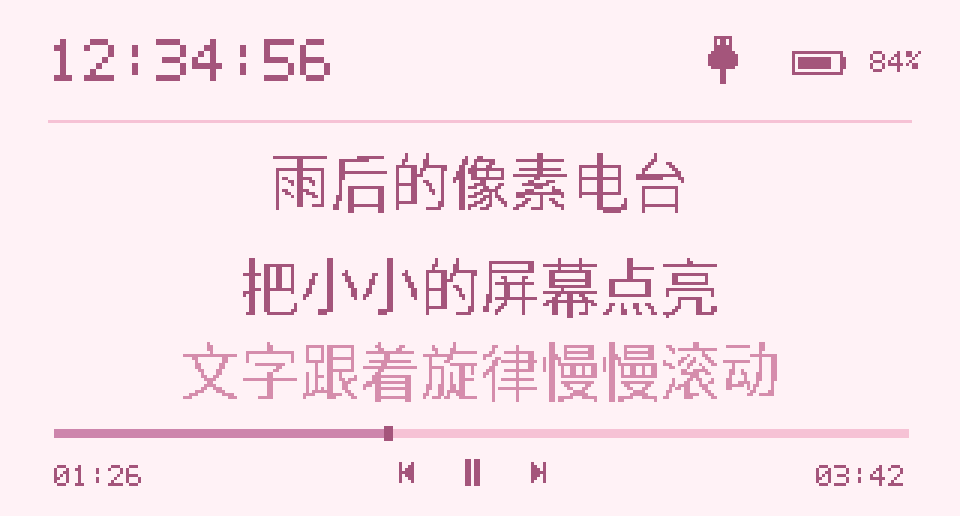
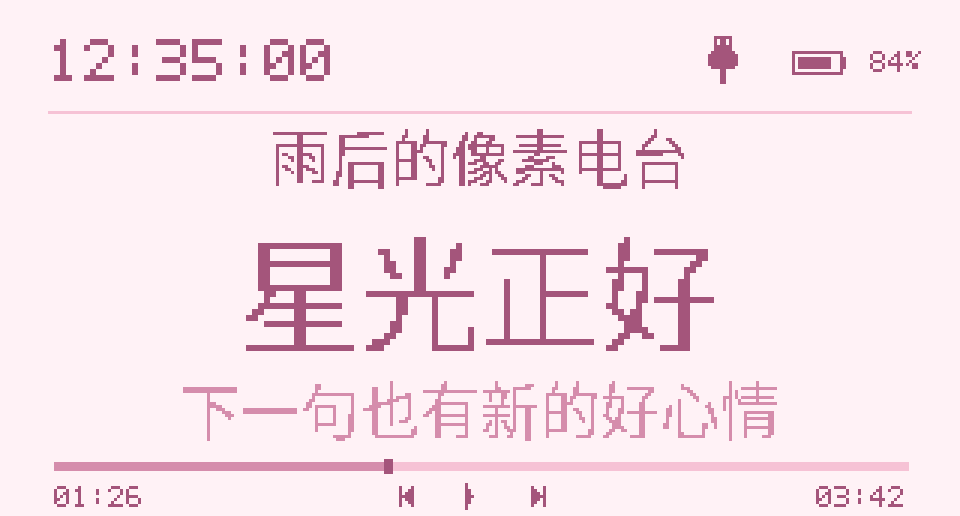
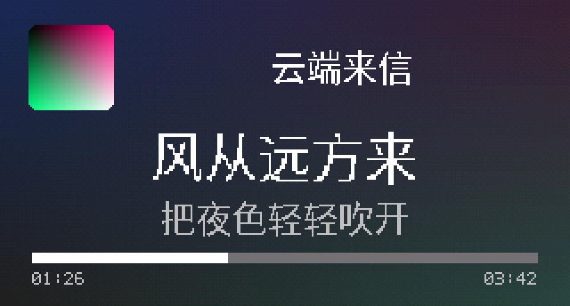
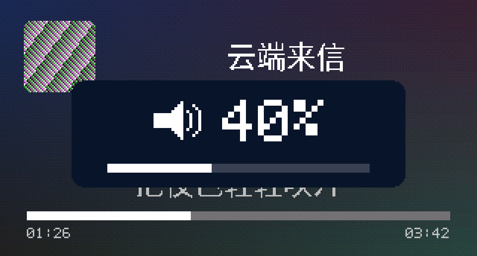
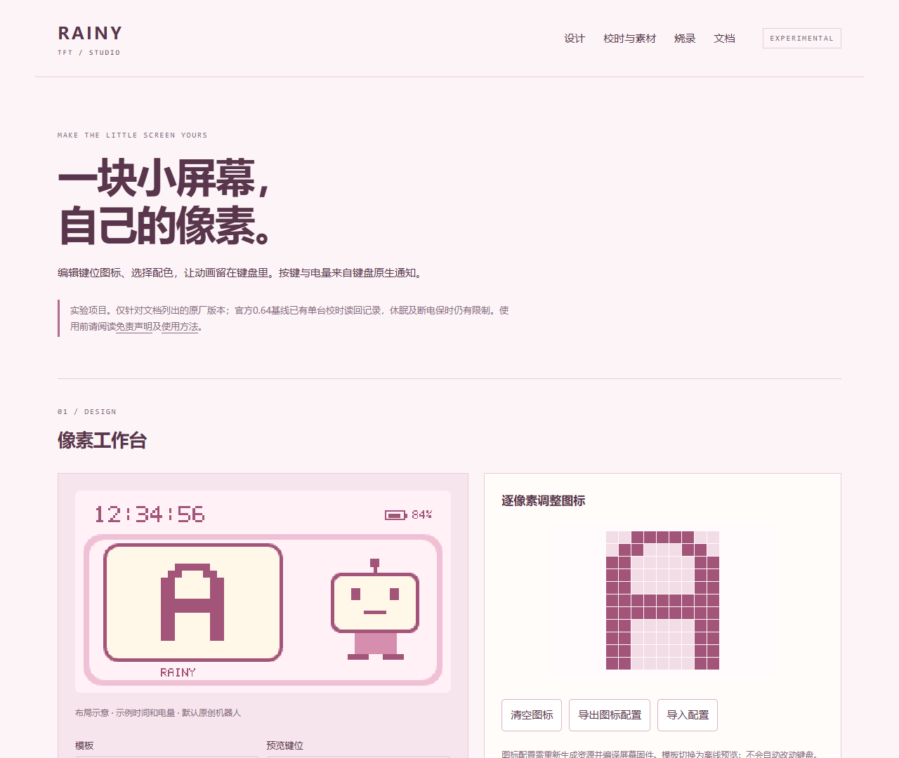
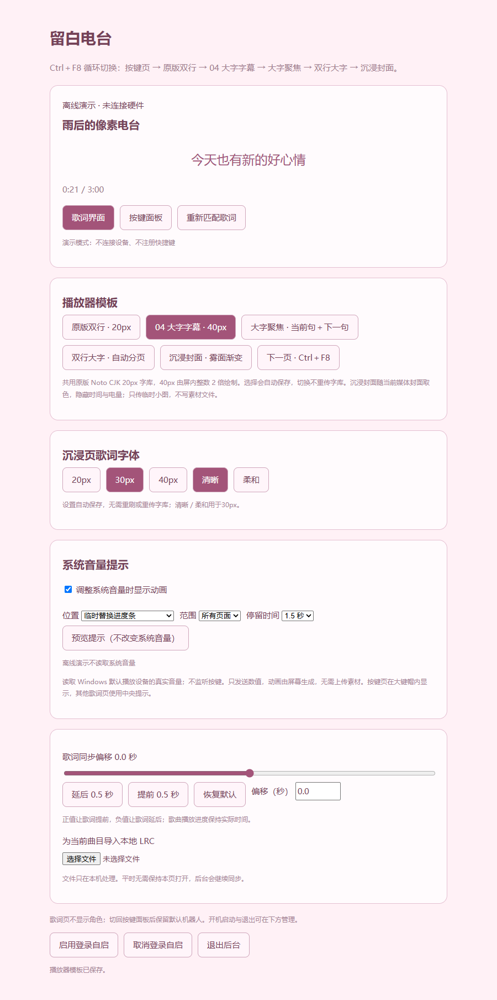

# Rainy75 V2 TFT 自定义固件与工具套件

已安装旧示例机器人、遇到动画和边框闪烁的用户：下载本仓库最新同主题 `assets/robot-*.gif` 覆盖 S1 即可尝试修复，无需重刷固件或字库。[操作步骤](docs/usage.md#已安装旧示例机器人出现闪烁时)

给 WOB Rainy75 V2 键盘的小屏幕加上一套自己可控的像素界面，目前包含两个部分：

1. **基础屏幕版**：模拟像素点阵显示（最近按下的大单键、带 Shift 符号转换）、24 小时数字时钟（含主控 RTC 同步方案）、电量图标与百分比、USB / 2.4G / 蓝牙连接图标，以及一只会待机眨眼的像素小机器人（樱花粉、薄荷绿、墨水灰三套配色）。刷好后完全脱离电脑独立工作。
2. **歌词播放器扩展（可选）**：在保留原有按键页的前提下，新增「留白电台」全宽歌词界面。默认采用 **40px 大字字幕 + 20px 歌名**，控制台也可一键切换成 **20px 双行歌词**（共用同一份字库，切字号无需重刷固件或重传字库）。支持 QQ 音乐、网易云音乐同步与 `Ctrl + F8` 六页循环；旧固件按能力降级。

本次更新按用途分为三类，已有用户先看 [升级对照表](docs/upgrade.md)，无需把所有功能都装一遍：

| 版本 / 用途 | 屏幕内容 | 日常依赖 | 入口 |
| --- | --- | --- | --- |
| A · 基础屏幕版 | 单键、时钟、电量、连接图标、原创机器人 | 无电脑后台；原生状态依设备可用于有线 / 2.4G / 蓝牙 | [基础版安装](docs/usage.md) |
| B · 传统歌词播放器 | 保留按键页，加四套点阵歌词模板、歌名与进度 | Windows + USB 后台 + 一份屏内字库 | [歌词安装](docs/lyrics.md) |
| C · 沉浸与音量增强 | 第五套封面取色播放器、20/30/40px歌词、系统音量动画 | 在歌词版上更新屏幕固件和后台；匹配原字库可复用 | [新增功能与升级](docs/upgrade.md#c-沉浸播放器与音量增强) |

软件版本、原厂基线与协议能力是不同概念。`alpha.5`是源码版本；主控仍为V7.1，歌词协议仍为LY1，新增功能按能力查询启用。**本次alpha.5仅修复后台快切阻塞，已有兼容用户更新并重启后台即可，无需重刷固件或重传素材。**

> 当前版本：`0.2.0-alpha.5`（社区实验项目，自有代码采用 [MIT License](LICENSE)）。


*上图为三套内置配色的软件渲染效果图（使用示例时间与电量），实际屏幕由 320×172 IPS 面板点亮。*

---

## 这是怎么做到的？（30 秒看懂原理）

Rainy75 V2 内部其实有两颗芯片在协同工作：

- **键盘主控（CH585，RISC-V）**：负责扫描按键、管理 USB / 2.4G / 蓝牙连接，以及维护内部 RTC 计时。
- **屏幕模块（AT32F435，ARM Cortex-M4）**：负责驱动 320×172 IPS 屏幕，并从外置 Flash 中读取原厂缓存的 GIF 动画。

项目没有推翻原厂框架重做整套图传协议，而是采用**「静态底图留设备 + 动态状态实时叠加」**的思路：

1. **GIF 当底图留在屏幕里**：把小机器人动画传到原厂的 **S1 槽位**。日常显示时，屏幕芯片循环播放本地缓存的 GIF，不用电脑反复传图。
2. **屏幕补丁实时叠画**：屏幕每次刷帧时，补丁代码在内存中把时钟、电量、连接图标和当前按键直接画到画面对应区域，**所以屏幕固件的主题色必须和上传的 S1 GIF 配色配套**，否则会出现色差。
3. **主控补丁负责守时**：原厂主控不会主动给屏幕同步真实时间。刷入主控补丁并在网页端校准一次后，主控会把“参考时间 + RTC 计数锚点”写入 Flash 专用页（`0x49000`），之后响应屏幕每30秒取时请求；计数与供电仍有效时可本地走秒，完全断电及长休眠的边界见下文。

---

## 基础版 vs 歌词扩展：怎么选？

按自己需要选择即可，不看歌词的话完全不用折腾字库和电脑后台。

| 对比项 | 基础屏幕版 | 歌词播放器扩展（可选） |
| --- | --- | --- |
| 屏幕功能 | 大单键显示、时钟、电量、连接状态、机器人动画 | 保留基础版全部功能，额外增加歌名、40px/20px 滚动歌词与进度条 |
| 日常电脑后台 | **不需要**，校好时间就可以关掉网页 | **需要**，Windows 后台常驻同步（控制网页可以关闭） |
| 连接方式 | 按键、电量、走时与动画支持 USB / 2.4G / 蓝牙 | **歌词同步仅支持 USB 有线模式**；切回按键页仍可用本地功能 |
| 所需构建内容 | 主控固件 + 普通 IPS 固件 + 主题 GIF | 在基础版之上，额外编译歌词版 IPS + 本地生成 `FONT.BIN` 字库 |
| 详细文档 | [基础版使用指南](docs/usage.md) | [歌词扩展安装与控制台](docs/lyrics.md) |
| AI 定制入口 | [基础版提示词](docs/ai-guide.md#基础版改图标与主题) | [歌词版提示词](docs/ai-guide.md#歌词版改布局与控制台) |



*默认歌词布局的软件预览（不是实机照片，40px大字字幕04）：由同一份 20px 字库在屏内整数 2 倍放大渲染，保留像素锐利感；字体衍生自 Noto CJK（[OFL-1.1](licenses/OFL-1.1.txt)）。*


*20px双行歌词的软件预览（不是实机照片，同时显示当前句与下一句），在控制台里点一下即可实时切换。*

---

| 大字聚焦：当前句 40px＋下一句 20px | 双行大字：40px，长句按字形换行分页 |
| --- | --- |
|  |  |

这两张也为真实固件机器码在模型中绘制的软件预览，不是实拍。前四套沿用构建时的主题；沉浸页会根据当前音乐封面自动取色。



沉浸页使用48px小封面与雾面渐变背景，隐藏时间、电量和连接顶栏；歌词默认30px清晰，可在控制台切换20/30/40px及30px柔和边缘。上图使用程序生成的示例封面与原创文字，不是实拍。



调节Windows系统音量时，可短暂显示中央扬声器、百分比和音量条，默认最后一次变化约一秒后收起；也可暂时替换沉浸页进度条。提示位置、范围和停留时间均可在控制台调整。上图是固件模型绘制，不是实拍。

## 核心功能一览

### 基础屏幕版

- **大单键显示**：直接接收键盘主控发来的原生通知，无需在电脑端安装全局键盘钩子。支持大号导航图标（回车、退格、空格、方向键、PgUp/PgDn、居中的 Win 四格图标）、`ESC` / `CTRL` / `ALT` / `FN` 文字显示，以及美式布局下的 Shift 上档符号映射。松开按键后保留最近一次按下的键（刚开机显示 `--`）。
- **RTC 时钟同步**：通过 USB 在网页工作台一键对时；刷完或完全断电重启后重对一次即可，不必重刷固件。
- **电量与模式图标**：自动读取原生电量和当前连接方式（USB / 2.4G / 蓝牙）。
- **自写 WebHID 工作台**：浏览器直接完成像素图标编辑、配色预览、一键校时、S1 动画上传以及双芯片应用区烧录校验。



该截图为未连接设备的工作台预览。

### 歌词播放器扩展

- **屏内字库**：把20px字库（`FONT.BIN`，约2.4MiB）一次性传进屏幕Flash；传统歌词换句只传字形编号与进度。沉浸页额外传1856B临时小封面，不写素材文件，正常更新不弹`Downloading`。支持通过校验旧字库头部安全释放空间并更换新字库（见 [更换已有字库](docs/lyrics.md#更换已有字库)）。
- **四套传统模板＋一套沉浸模板**：传统布局为原版双行、04大字字幕、大字聚焦、双行大字；沉浸页为小封面与雾面渐变背景。切换不重传字库，沉浸歌词另可调20/30/40px，默认30px清晰。
- **智能匹配与多语言**：自动捕获 QQ 音乐 / 网易云音乐当前播放状态，支持简中、繁中、日文、英文混排。长歌名独立滚动，长歌词按时间分段滚动，换句带上下过渡动画。匹配时会核对歌手、Live/Remix 版本与时长，减少匹配错误。
- **「留白电台」本机控制台**：支持切换字号、调节 `±10 秒` 歌词偏移（0.1 秒步进，自动保存）、导入本地 `.lrc` 文件、手动重新匹配、管理 Windows 登录自启。
- **全局快捷键**：`Ctrl + F8`循环按键页和五套播放器，只注册该热键。切页优先于字形与封面等待任务；这项卡顿修复仅需更新后台。



控制台截图使用原创演示数据，不读取播放器、音量或真实设备。

---

## 当前进展与已知限制

本项目仍在迭代，以下几点在动手前请先了解清楚：

| 模块 | 当前版本 | 实机情况与说明 |
| --- | --- | --- |
| **普通 IPS 界面** | `0.6.3 / L6` | 保留 `0.6.2` 显示逻辑，新增了只读芯片容量/型号查询；默认机器人素材与新构建需上机实际看下效果 |
| **歌词播放器扩展** | `L6 + LY1` | 同源版本（含 20/40 字号切换与字库安全替换）在单台 `1024KiB AT32F435 / 4MiB 外置 Flash` 设备上跑通过 QQ 音乐；公开默认字体/主题和网易云最新 Elog 进度适配仍待更多实机复核 |
| **主控时钟桥** | `V7.1` | 官方0.64基线已有单台设备刷写与校时读回；不代表完全断电或全部批次保时 |
| **休眠与模式切换** | 实验中 | 依赖各批次实际供电情况与休眠逻辑，尚未测遍所有使用场景 |
| **完全断电保时** | 硬件限制 | 开发设备完全断电后RTC计数可能重置，旧锚点失效；需要USB重新校时，未证明所有批次的后备供电条件 |

> 仓库已经在 [vendor/](vendor/README.md) 里随附了一套配套的原厂离线烧录网页 `Rainy75V2烧录工具20261112-1beta1.html`（内含键盘 `0x3F`、接收器 `0x26`、屏幕 `0x0002` 三份原厂固件，**版权归 WOB 原厂所有、不适用 MIT 协议**）；但**仍不包含** WCH 官方 `libISP585.a`、完整编译后的 `.bin` 或个人角色图。所有自定义补丁固件依然需要你在本地结合原厂输入重新编译生成。支持的具体硬件和版本哈希见 [兼容性说明](docs/compatibility.md)。

---

## 快速上手流程

如果你只是想浏览代码、画像素图标或离线体验界面，不需要准备原厂固件或连接键盘。如果要刷上实机，按下面顺序操作：

1. **看一眼兼容性与注意事项**
   阅读 [兼容性说明](docs/compatibility.md) 和 [免责声明](DISCLAIMER.md)，确认自己的键盘型号和手头有匹配的原厂固件文件（强烈建议先生成原厂恢复包）。

2. **在本地提取原厂镜像并生成补丁固件**
   按照 [本地构建指南](docs/build.md) 装好工具链，用 `tools/extract_stock.py` 从 [vendor/Rainy75V2烧录工具20261112-1beta1.html](vendor/Rainy75V2烧录工具20261112-1beta1.html) 解出原厂 `.bin`、再放入 `libISP585.a`，编译出主控和屏幕固件、以及对应的 `manifest.json` 和主题 GIF。

3. **打开本地 WebHID 工作台**
   ```sh
   python tools/serve.py
   ```
   用桌面版 **Chrome** 或 **Edge** 打开 <http://127.0.0.1:8765/web/>（操作前先退出 WOB 官方驱动页面）。

4. **刷入基础版并校时**
   按照 [基础版使用指南](docs/usage.md) 依次烧录主控与 IPS 固件、把对应配色的 GIF 上传到 S1 槽位、最后点一次对时按钮即可。

5. **（可选）加装歌词扩展**
   基础版跑通后，再按照 [歌词扩展安装指南](docs/lyrics.md) 生成 `FONT.BIN`、刷入歌词版 IPS、上传字库并运行：
   ```sh
   npm install
   npm run lyrics
   ```
   如果想先不接键盘离线看看控制台长什么样，可以直接运行：
   ```sh
   npm run lyrics:demo
   ```

---

## 仓库目录与本地测试

```text
firmware/ips/         基础版屏幕固件补丁（界面绘制、按键与状态处理、RTC 接收）
firmware/ips-lyrics/  歌词扩展固件代码（Bank2歌词、临时封面、音量提示、字库安全维护）
firmware/main/        主控固件补丁（RTC 锚点保存、时钟同步桥）
desktop/              Windows 歌词后台（SMTC / Elog 读取、歌词检索、Ctrl+F8 热键、控制台）
profiles/             可编辑配置（大按键点阵 keys.json、5x7 字体 font.json、三套配色 themes.json）
assets/               默认几何机器人 GIF 与效果预览图
web/                  纯本地 WebHID 控制台（图标编辑器、校时、素材与字库上传、双芯片烧录）
tools/                原厂固件提取、补丁构建脚本、字库打包、本地 HTTP 服务与 ARM 仿真测试
vendor/               原厂离线烧录网页 HTML（内嵌非 MIT 原厂二进制，供提取输入与救砖恢复使用）
tests/                主机协议、媒体匹配、桌面控制台与素材单元测试
docs/                 使用、构建、协议、定制、救砖与 AI 协作文档
```

运行仓库自带的自动化测试（Python 测素材与字库格式，Node 测协议与歌词逻辑，不需要连接键盘）：

```sh
python -m unittest discover -s tests -p "test_*.py"
npm test
python tools/check_release.py
```

如果要用 AI Agent 协助定制图标、改配色或排查问题，可以先参考 [AI 协作指南](docs/ai-guide.md) 和 [AGENTS.md](AGENTS.md)。如果想把这个项目「静态素材留设备 + 少量状态驱动」的做法用到其他外设上，可以看 [外设开发思路](docs/peripheral-ideas.md)。

---

## 许可与致谢

- 仓库自有源码、文档和默认几何机器人素材按 [MIT License](LICENSE) 开源，请保留作者署名。
- [vendor/](vendor/README.md) 中的离线烧录 HTML 及其内嵌原厂固件二进制（键盘 `0x3F`、接收器 `0x26`、屏幕 `0x0002`）归各自原权利人所有，**不适用 MIT 协议**。
- 歌词扩展使用的 20px 字库衍生自 Google / Adobe **Noto Sans CJK SC**，沿用 [SIL OFL-1.1](licenses/OFL-1.1.txt)。
- 网易云音乐本地 Elog 解析结构参考了上游开源项目，保留对应 [MIT 声明](licenses/netease-elog-MIT.txt)。
- 完整依赖与第三方版权说明见 [THIRD_PARTY_NOTICES.md](THIRD_PARTY_NOTICES.md)，风险与使用边界见 [DISCLAIMER.md](DISCLAIMER.md)，提 Issue 或 PR 请看 [CONTRIBUTING.md](CONTRIBUTING.md)。
